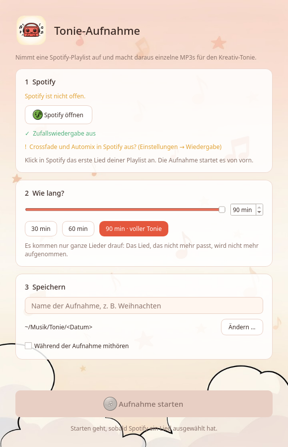

# Tonie-Aufnahme

Eine kleine Linux-App, die eine Spotify-Playlist aufnimmt und daraus einzelne MP3-Dateien macht, fertig zum Hochladen auf einen **Kreativ-Tonie**.

## Was die App macht

1. Du startest in Spotify deine Playlist.
2. Die App nimmt sie in Echtzeit auf (eine Stunde Musik dauert also eine Stunde).
3. Jedes Lied landet als eigene MP3 mit Interpret und Titel in `Musik/Tonie/<Name>`.
4. Du ziehst die MP3s auf [my.tonies.com](https://my.tonies.com) auf deinen Kreativ-Tonie.

Während der Aufnahme hörst du nichts (Spotify spielt auf ein stummes, eigenes Gerät). Wer mithören möchte, setzt das Häkchen „Während der Aufnahme mithören“.

Gut zu wissen:

- Auf einen Kreativ-Tonie passen bis zu 90 Minuten. Die App nimmt nur ganze Lieder: Das Lied, das nicht mehr passt, wird weggelassen.
- Werbung und Lieder, die nicht ganz durchgelaufen sind, werden nicht gespeichert.
- Bricht eine Aufnahme ab, gib beim nächsten Mal denselben Namen ein: Die App überspringt die Lieder, die schon da sind, und macht weiter.

## Was du brauchst

- Linux mit grafischer Oberfläche (getestet mit KDE Plasma unter CachyOS/Arch)
- Die **Spotify-Desktop-App** (nicht die Webseite)
- Ein paar Programme, die die meisten Systeme schon haben: Python 3 mit PySide6, ffmpeg, playerctl und die PulseAudio-Werkzeuge (`parec`, `pactl`; mit PipeWire funktioniert das genauso)

## Installieren

Lade unter [Releases](../../releases/latest) die passende Datei herunter:

- **Debian 13, Ubuntu 25.04 oder neuer:** die `.deb`-Datei. Doppelt anklicken und installieren; alles Nötige kommt automatisch mit.
- **Jedes andere Linux** (Arch, Fedora, ältere Ubuntu …): das `AppImage`. Rechtsklick → Eigenschaften → „Ausführbar“ anhaken, dann doppelt anklicken. Dafür müssen `ffmpeg`, `playerctl` und die PulseAudio-Werkzeuge installiert sein (siehe unten).

Danach heißt die App **Tonie-Aufnahme**.

Ohne Paket, direkt aus dem Quellcode

1. Oben auf **Code → Download ZIP** klicken und entpacken (oder `git clone`).
2. Im Ordner ein Terminal öffnen und `./install.sh` eingeben.
3. Fehlt etwas, sagt dir das Skript, welchen Befehl du für dein System eingeben musst.

Deinstallieren geht mit `./uninstall.sh`. Deine Aufnahmen bleiben dabei erhalten.

Programme, die fürs AppImage und den Quellcode auf dem System sein müssen:

- Arch/CachyOS: `sudo pacman -S playerctl ffmpeg libpulse` (für den Quellcode zusätzlich `pyside6`)
- Fedora: `sudo dnf install playerctl ffmpeg pulseaudio-utils` (zusätzlich `python3-pyside6`)
- Ubuntu/Debian: `sudo apt install playerctl ffmpeg pulseaudio-utils` (zusätzlich `python3-pyside6.qtwidgets`)

## So nimmst du auf

1. **Tonie-Aufnahme** öffnen und auf **Spotify öffnen** klicken.
2. In Spotify **Zufallswiedergabe**, **Crossfade** und **Automix** ausschalten (Einstellungen → Wiedergabe). Sonst schneidet die App Lieder falsch oder wirft sie weg.
3. In Spotify das **erste Lied** deiner Playlist anklicken. Die App spult es auf den Anfang zurück.
4. Länge wählen (z. B. „90 min · voller Tonie“) und einen Namen eingeben, z. B. „Weihnachten“.
5. **Aufnahme starten** und Spotify in Ruhe lassen, bis die App „Fertig!“ meldet.
6. **Zu my.tonies.com** öffnen, den Kreativ-Tonie wählen und die MP3s aus dem Ordner ins Fenster ziehen.

Tipp: Benutze während der Aufnahme dasselbe Spotify-Konto nicht auf einem anderen Gerät. Sonst springt Spotify dorthin und die Aufnahme bricht ab.

Für Fortgeschrittene gibt es auch eine Kommandozeile: `tonie-aufnahme -m 60` nimmt 60 Minuten auf.

## Rechtliches

Die App nimmt nur auf, was du ohnehin hörst, und umgeht keinen Kopierschutz. Eine Privatkopie für die eigene Familie ist in Deutschland in der Regel erlaubt. Spotifys Nutzungsbedingungen untersagen das Aufnehmen aber. Ob du die App benutzt, entscheidest du selbst; die Aufnahmen sind nur für den privaten Gebrauch.

Dieses Projekt hat nichts mit Spotify oder Boxine (tonies) zu tun.

## Mitmachen

Fehler gefunden oder eine Idee? Gern als [Issue](../../issues) melden. Änderungen bitte als Pull Request gegen den Branch `develop` stellen, nicht gegen `main`.

## Lizenz

MIT, siehe [LICENSE](LICENSE). Die Bilder der App wurden mit KI erzeugt und stehen unter derselben Lizenz.
